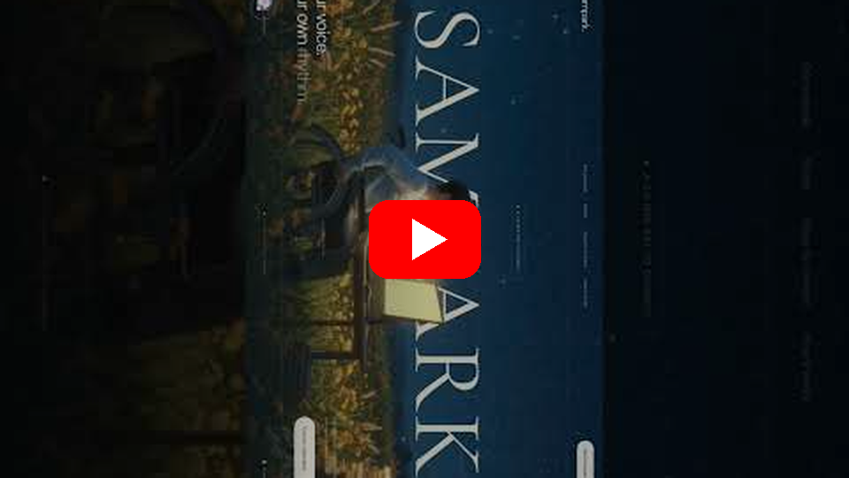
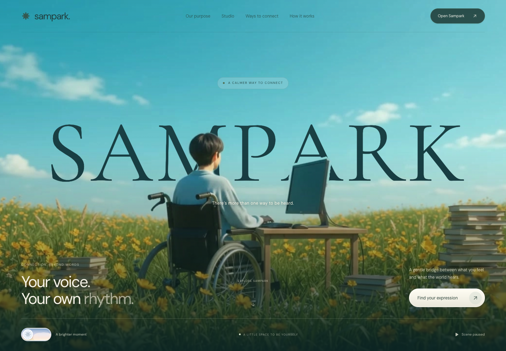
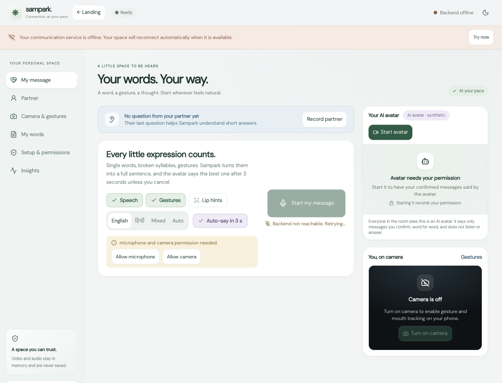

# Linguistic Assist / SampArk — Multimodal Communication Support

> A communication-assistance prototype that gathers speech fragments, gesture tokens and lip-movement hints, then lets the person choose what to say.

**Role and recognition:** Team lead; **ElevenLabs National Hackathon winner**, ₹5,100 and US$500 credits recorded in the project résumé.

**Source code:** [pankti0409/linguistic_assist](https://github.com/pankti0409/linguistic_assist) is already public and is maintained under a teammate's GitHub account. This repository is Om Rashiya's public project case study and does not claim ownership of that source.

## Watch the project

Select the YouTube preview to open the project Short.

## App screenshots

The first image is the SampArk landing experience. The second is the local communication workspace after its UI finished loading; the local API was intentionally offline during capture, so its connection banner is visible rather than hidden.

## The problem and interaction

Some people cannot reliably produce a complete spoken sentence in one uninterrupted turn. SampArk explores combining small pieces of communication over time: microphone speech, hand-gesture labels, mouth activity or optional lip-reading text, a partner's recent question, and the person's phrasebook. It proposes a small set of candidate messages and keeps the person in control of the final response.

The core interaction is intentionally confirmation-first:

1. A person grants separate microphone, camera, avatar and personalization consent.
2. The application collects short evidence fragments while the relevant permission is active.
3. A candidate sentence is assembled from traceable words and the conversation context.
4. The person reviews, edits, confirms, rejects or asks for clarification.
5. Only a confirmed sentence can be sent to a voice output.
6. The UI discloses when an AI avatar or synthetic voice is being used.

## Architecture

~~~mermaid
flowchart LR
  PERSON[Person using the assistant] --> UI[React / TypeScript SampArk UI]
  UI --> CONSENT[Local consent and capability state]
  MIC[Microphone] --> SPEECH[Speech transcription adapter]
  CAM[Camera frames in memory] --> GESTURE[Gesture and mouth-activity adapters]
  GESTURE --> EVIDENCE[Evidence fragments]
  SPEECH --> EVIDENCE
  PARTNER[Conversation partner context] --> CONTEXT[Context and phrasebook]
  EVIDENCE --> CONTEXT
  CONTEXT --> CANDIDATES[Candidate message generation]
  CANDIDATES --> VALIDATE[Word provenance validator]
  VALIDATE --> REVIEW[Person reviews and confirms]
  REVIEW -->|confirmed text only| OUTPUT[ElevenLabs / local audio / optional avatar]
  REVIEW -->|reject or edit| CONTEXT
  OUTPUT --> PERSON
~~~

### Confirmation and privacy flow

~~~mermaid
sequenceDiagram
  participant P as Person
  participant U as SampArk UI
  participant L as Local capture and fragment store
  participant A as Suggestion service
  participant V as Provenance validator
  participant O as Voice output
  P->>U: Grant a specific permission
  U->>L: Start only that microphone or camera capability
  L->>A: Send permitted text evidence, not raw media
  A-->>V: Return candidate sentences
  V-->>U: Mark traceable words and reject unsupported additions
  U-->>P: Show options and explain additions
  P->>U: Confirm one sentence
  U->>O: Send the confirmed text with disclosure
  O-->>P: Speak the selected message
~~~

## Technical components

The public source describes a local Python backend and a React/TypeScript/Vite frontend. Service adapters cover speech recognition and synthesis, language reconstruction, gesture processing, optional lip-reading models and optional avatar output. A WebSocket event stream supports a live frontend. The backend binds to localhost by default and supports an optional access token.

The privacy design keeps raw camera frames and audio in memory; only permitted text evidence is sent to configured language services. The user grants camera and microphone permissions separately. The word-provenance check prevents a generated sentence from silently introducing unsupported content, subject to the documented validation rules.

## What has and has not been verified

The source project's README reports webcam/face tracking, gesture tokens, transcription experiments and local ElevenLabs output tested in the development setup. It also explicitly lists Groq reconstruction, avatar output and lip-text model execution as not yet fully verified. Lip reading depends on a separate research model and is optional; without its checkpoint, the system can fall back to mouth-activity hints.

This is an **assistive proof of concept**, not a diagnostic device, clinical recommendation or validated accessibility product. It needs testing with people who use augmentative communication, careful consent design, accessible recovery paths and evaluation across different speech, movement and lighting conditions.

## Award context

The project résumé identifies Linguistic Assist as an ElevenLabs national hackathon winner and records ₹5,100 plus US$500 in credits. The source repository is collaborative and publicly available under a teammate's account; this showcase summarizes the team's work and links to the original source.

## Screenshots and video

The YouTube card is a clickable thumbnail linked to the supplied Short. GitHub does not render embedded YouTube iframes in README files, so the image acts as the visible video window and opens the real player when selected.
